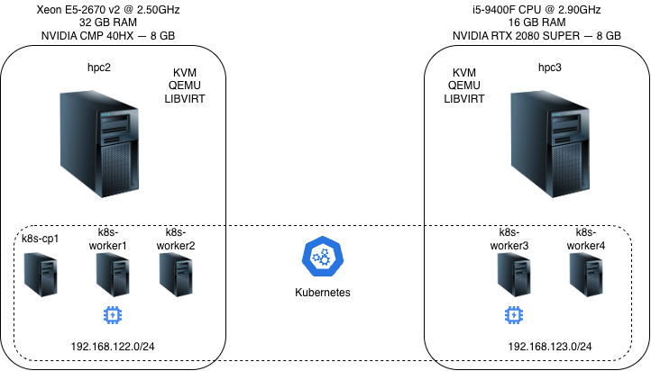

# Kubernetes Home Lab — расширение кластера с помощью Terraform



## О проекте

В этом проекте показано, как расширить существующий Kubernetes-кластер двумя дополнительными Worker-нодами, развернув виртуальные машины на отдельном гипервизоре с помощью **Terraform, KVM, QEMU и libvirt**.

В качестве дополнительного узла используется сервер с NVIDIA RTX 2080 SUPER, проброшенной непосредственно в виртуальную машину через PCI passthrough.

Проект сопровождает практическую серию видео по построению и расширению домашней Kubernetes-инфраструктуры.

## Архитектура

Инфраструктура состоит из двух физических гипервизоров.

### hpc2 — существующая инфраструктура

| Компонент | Характеристики |
|---|---|
| CPU | Intel Xeon E5-2670 v2 @ 2.50 GHz |
| RAM | 32 GB |
| GPU | NVIDIA CMP 40HX — 8 GB |
| Виртуализация | KVM / QEMU / libvirt |
| Сеть | 192.168.122.0/24 |

На этом сервере работают существующие Kubernetes-ноды:

- `k8s-cp1`
- `k8s-worker1`
- `k8s-worker2`

### hpc3 — дополнительный гипервизор

| Компонент | Характеристики |
|---|---|
| CPU | Intel Core i5-9400F @ 2.90 GHz |
| RAM | 16 GB |
| GPU | NVIDIA RTX 2080 SUPER — 8 GB |
| Виртуализация | KVM / QEMU / libvirt |
| Сеть | 192.168.123.0/24 |

На этом сервере Terraform создаёт две виртуальные машины:

| VM | vCPU | RAM | Диск | GPU |
|---|---:|---:|---:|---|
| k8s-worker3 | 4 | 6 GB | 30 GB | RTX 2080 SUPER |
| k8s-worker4 | 2 | 4 GB | 30 GB | Нет |

## Используемые технологии

- **KVM / QEMU** — аппаратная виртуализация.
- **libvirt** — управление виртуальными машинами.
- **Terraform** — декларативное создание инфраструктуры.
- **cloud-init** — первоначальная настройка виртуальных машин.
- **Ubuntu Server 24.04** — операционная система виртуальных машин.
- **Kubernetes / kubeadm** — управление кластером.
- **NVIDIA GPU** — аппаратное ускорение вычислений.

## Структура репозитория

```text
.
├── cloud-init/
│   └── user-data.yaml.tftpl
├── install_k8s.sh
├── main.tf
├── prepare-script.txt
├── variables.tf
├── versions.tf
├── .gitignore
└── README.md
```

## Требования

Для повторения проекта понадобятся:

- Linux-сервер с установленными KVM, QEMU и libvirt.
- Настроенная сеть libvirt `lab-net`.
- Ubuntu 24.04 cloud image в хранилище libvirt.
- Установленный Terraform.
- SSH-ключ для доступа к виртуальным машинам.
- Доступность Kubernetes API существующего кластера из новой сети.

## Развёртывание виртуальных машин

Перейдите в каталог проекта и настройте публичный SSH-ключ:

```bash
export TF_VAR_ssh_public_key="$(cat ~/.ssh/id_ed25519.pub)"
```

Инициализируйте Terraform:

```bash
terraform init
```

Проверьте план:

```bash
terraform plan
```

Создайте виртуальные машины:

```bash
terraform apply
```

После подтверждения Terraform создаст `k8s-worker3` и `k8s-worker4` на гипервизоре hpc3.

## Подготовка Kubernetes-нод

После создания виртуальных машин необходимо:

1. Проверить сетевую доступность новых VM.
2. Подготовить Ubuntu для работы Kubernetes.
3. Установить и настроить containerd.
4. Установить kubelet, kubeadm и kubectl.
5. Получить актуальную команду подключения с control-plane.
6. Подключить Worker-ноды к существующему кластеру.

Команду `kubeadm join` необходимо генерировать непосредственно перед подключением:

```bash
kubeadm token create --print-join-command
```

## Проверка кластера

На control-plane выполните:

```bash
kubectl get nodes -o wide
```

После успешного подключения новые Worker-ноды должны появиться в списке Kubernetes-нод.

## Удаление виртуальных машин

Для удаления ресурсов, созданных Terraform:

```bash
terraform destroy
```

**Внимание:** команда удаляет ресурсы, которыми управляет текущая Terraform-конфигурация. Перед подтверждением внимательно проверьте план удаления.

---

## Видео

Практический процесс развёртывания и подключения Worker-нод показан в видео.

[YouTube — ссылка будет добавлена]

## Примечание

Это домашняя лабораторная инфраструктура. IP-адреса, сетевые настройки, пути к образам и параметры виртуальных машин необходимо адаптировать под собственное окружение.

Не публикуйте приватные SSH-ключи, пароли, действующие Kubernetes-токены и Terraform state-файлы.